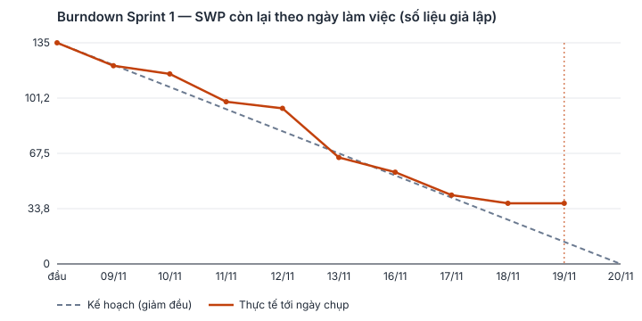

# Báo cáo tiến độ — sprint giả lập trên GitHub Project

<!-- gen:progress-dau:start -->
Iteration trên Project: «Sprint 1» (field Iteration «Sprint»), 09/11/2026 – 22/11/2026. Báo cáo là ảnh chụp ngày làm việc 9/10 của Sprint 1 (19/11/2026), số liệu giả lập: Status, Spent time, Done Date do kịch bản giả lập ghi, không phải kết quả một sprint chạy thật.
<!-- gen:progress-dau:end -->

Đây là báo cáo của một Sprint giả lập: issue được xếp vào Iteration thật trên Project, còn Status, Spent time và Done Date do kịch bản giả lập ghi lên như sau một Sprint chạy thật. Giả lập không đóng issue trên GitHub: issue xong chỉ mang Status Closed trên board và ngày ở trường Done Date, còn trạng thái của issue trên GitHub vẫn là mở. Các issue thật sự đóng trên GitHub là issue thay thế, không thuộc Sprint và không tính trong các bảng dưới.

## Tóm tắt

<!-- gen:pr-tom-tat:start -->
- Ảnh chụp ngày 19/11/2026, ngày làm việc 9/10 của Sprint 1 (09/11/2026 – 22/11/2026). Số liệu giả lập, không phải kết quả một sprint chạy thật.
- Hoàn thành 55/98 SWP (56%) của Sprint 1.
- Nguyên nhân trượt chính: chờ việc đứng trước hoặc môi trường chưa sẵn sàng — 6 việc, 24 SWP trên 43 SWP chưa xong vì trượt; chờ câu trả lời cho các câu hỏi gửi quý khách — 7 việc, 15 SWP; chờ quyết định kỹ thuật nội bộ (Tech Lead) — 2 việc, 4 SWP. Việc nội bộ chính: [#513](https://github.com/hoctt-1111/sakura-market-lab5/issues/513) — Tech Lead chưa chốt nơi giữ dòng đảo và khung nhìn chuẩn: hai phương án đụng nhau ở bảng nào giữ dòng đảo, cần rà cùng BE-2 trước khi chốt (chi tiết ở mục Burndown).
- Cần quý khách trả lời 31 câu; hạn gần nhất 09/11/2026 (hạn bên làm đề xuất trước buổi khởi động dự án), 10 câu đã quá hạn ở ngày chụp; thêm 2 câu có hạn gốc trước ngày bắt đầu dự án 09/11/2026, vẫn chưa có trả lời ở ngày chụp (bảng ở cuối báo cáo).
- Dự báo so với kế hoạch 19 sprint. Theo năng lực giờ kế hoạch: 35 sprint (vai nghẽn QA); theo tốc độ hoàn thành giả lập tới ngày chụp của Sprint 1: 33 sprint (số thô, một sprint dữ liệu — dự báo thô, con số sẽ đổi khi có thêm sprint thật). Cách tính theo tốc độ hoàn thành giả lập: cả đội 55 SWP/sprint, backlog còn 1.454 SWP; vai nghẽn BE-1 còn 314 SWP, làm 10 SWP mỗi sprint nên cần thêm 32 sprint. Hai số khác nhau vì số đầu tính theo giờ của từng vai, số sau theo SWP giả lập đã xong tới ngày chụp.
- Vai chưa có việc xong trong Sprint 1 nên chưa dự báo riêng: BrSE, QA; dự báo toàn dự án theo tốc độ vì thế chưa xác định; số sprint theo tốc độ ở trên không dùng làm dự báo, chỉ tính trên các vai đã đo được.

| Vai | SWP toàn backlog | Xong Sprint 1 | Còn lại | Sprint cần thêm |
| --- | --- | --- | --- | --- |
| BE-1 | 324 | 10 | 314 | 32 |
| BE-2 | 258 | 13 | 245 | 19 |
| BrSE | 90 | 0 | 90 | chưa đo được |
| FE-1 | 119 | 12 | 107 | 9 |
| FE-2 | 126 | 14 | 112 | 8 |
| Infra | 64 | 2 | 62 | 31 |
| PM | 30 | 4 | 26 | 7 |
| QA | 498 | 0 | 498 | chưa đo được |
<!-- gen:pr-tom-tat:end -->

<!-- gen:pr-tom-tat-ja:start -->
**進捗サマリー**（2026年11月19日時点・シミュレーション値）

- Sprint 1 の完了率は56%（98 SWP 中 55 SWP）でございます。
- 主な遅延要因は、先行作業・環境の準備待ち（6件、24 SWP）でございます。このほか、お客様へのご確認事項のご回答待ち（7件、15 SWP）がございます。このほか、社内の技術判断（テックリード）の確定待ち（2件、4 SWP）がございます。社内の案件（主に[#513](https://github.com/hoctt-1111/sakura-market-lab5/issues/513)）につきましては、弊社にて早急に対応いたします。詳細は本報告書のバーンダウン欄に記載しております。
- ご回答をお願いしたい事項は31件で、最も早い期限は2026年11月9日（キックオフ前に弊社よりご提案した期限）でございます（うち10件は期限を経過しております）。お手数をおかけいたしますが、お早めにご回答いただけますと幸いです。このほか、キックオフ（2026年11月9日）以前を当初の期限としておりました事項のうち、本報告時点でご回答をいただいていないものが2件ございます。
- 計画19スプリントに対し、計画上の時間ベースの稼働能力では35スプリント（最も時間を要する担当：QA）、Sprint 1 のシミュレーション上の完了速度（報告時点）に基づきますと、最も時間を要する担当（BE-1）は残り314 SWP、1スプリントあたり10 SWP のため、合計33スプリント（概算値、1スプリント分のデータ）を要する見込みでございます。
- BrSE、QA は完了作業がまだないため、速度に基づく全体の見込みは確定しておりません。
- ※1スプリント分のデータに基づく概算のため、今後のスプリント実績により見直してまいります。
<!-- gen:pr-tom-tat-ja:end -->

## Trạng thái

Đếm từ chính Project ở ảnh chụp cuối kỳ báo cáo.

<!-- gen:progress-trang-thai:start -->
| Trạng thái | Số issue | Tổng SWP | Trong Sprint | Ghi chú |
| --- | --- | --- | --- | --- |
| New | 567 | 1.411 | 0 | việc lá/INV 405 · story/epic 162 |
| Planning | 2 | 8 | 2 | việc lá/INV 2 |
| In Progress | 25 | 0 | 0 | story/epic 25 |
| In Review | 4 | 16 | 4 | việc lá/INV 4 |
| Pending | 9 | 19 | 9 | việc lá/INV 9 |
| Closed | 20 | 55 | 20 | việc lá/INV 20 |

Tổng SWP chỉ cộng việc lá và INV (story, epic là tổng con nên không cộng lại).

Bảng không tính 52 issue đã đóng vì được thay thế: [#176](https://github.com/hoctt-1111/sakura-market-lab5/issues/176), [#187](https://github.com/hoctt-1111/sakura-market-lab5/issues/187), [#188](https://github.com/hoctt-1111/sakura-market-lab5/issues/188), [#230](https://github.com/hoctt-1111/sakura-market-lab5/issues/230), [#446](https://github.com/hoctt-1111/sakura-market-lab5/issues/446), [#453](https://github.com/hoctt-1111/sakura-market-lab5/issues/453), [#447](https://github.com/hoctt-1111/sakura-market-lab5/issues/447), [#454](https://github.com/hoctt-1111/sakura-market-lab5/issues/454), [#450](https://github.com/hoctt-1111/sakura-market-lab5/issues/450), [#457](https://github.com/hoctt-1111/sakura-market-lab5/issues/457), [#451](https://github.com/hoctt-1111/sakura-market-lab5/issues/451), [#458](https://github.com/hoctt-1111/sakura-market-lab5/issues/458), [#452](https://github.com/hoctt-1111/sakura-market-lab5/issues/452), [#459](https://github.com/hoctt-1111/sakura-market-lab5/issues/459), [#501](https://github.com/hoctt-1111/sakura-market-lab5/issues/501), [#506](https://github.com/hoctt-1111/sakura-market-lab5/issues/506), [#502](https://github.com/hoctt-1111/sakura-market-lab5/issues/502), [#507](https://github.com/hoctt-1111/sakura-market-lab5/issues/507), [#529](https://github.com/hoctt-1111/sakura-market-lab5/issues/529), [#539](https://github.com/hoctt-1111/sakura-market-lab5/issues/539), [#540](https://github.com/hoctt-1111/sakura-market-lab5/issues/540), [#671](https://github.com/hoctt-1111/sakura-market-lab5/issues/671), [#673](https://github.com/hoctt-1111/sakura-market-lab5/issues/673), [#672](https://github.com/hoctt-1111/sakura-market-lab5/issues/672), [#433](https://github.com/hoctt-1111/sakura-market-lab5/issues/433), [#439](https://github.com/hoctt-1111/sakura-market-lab5/issues/439), [#440](https://github.com/hoctt-1111/sakura-market-lab5/issues/440), [#441](https://github.com/hoctt-1111/sakura-market-lab5/issues/441), [#461](https://github.com/hoctt-1111/sakura-market-lab5/issues/461), [#471](https://github.com/hoctt-1111/sakura-market-lab5/issues/471), [#470](https://github.com/hoctt-1111/sakura-market-lab5/issues/470), [#2](https://github.com/hoctt-1111/sakura-market-lab5/issues/2), [#3](https://github.com/hoctt-1111/sakura-market-lab5/issues/3), [#4](https://github.com/hoctt-1111/sakura-market-lab5/issues/4), [#7](https://github.com/hoctt-1111/sakura-market-lab5/issues/7), [#5](https://github.com/hoctt-1111/sakura-market-lab5/issues/5), [#8](https://github.com/hoctt-1111/sakura-market-lab5/issues/8), [#9](https://github.com/hoctt-1111/sakura-market-lab5/issues/9), [#555](https://github.com/hoctt-1111/sakura-market-lab5/issues/555), [#557](https://github.com/hoctt-1111/sakura-market-lab5/issues/557), [#485](https://github.com/hoctt-1111/sakura-market-lab5/issues/485), [#490](https://github.com/hoctt-1111/sakura-market-lab5/issues/490), [#489](https://github.com/hoctt-1111/sakura-market-lab5/issues/489), [#486](https://github.com/hoctt-1111/sakura-market-lab5/issues/486), [#492](https://github.com/hoctt-1111/sakura-market-lab5/issues/492), [#491](https://github.com/hoctt-1111/sakura-market-lab5/issues/491), [#487](https://github.com/hoctt-1111/sakura-market-lab5/issues/487), [#494](https://github.com/hoctt-1111/sakura-market-lab5/issues/494), [#493](https://github.com/hoctt-1111/sakura-market-lab5/issues/493), [#488](https://github.com/hoctt-1111/sakura-market-lab5/issues/488), [#496](https://github.com/hoctt-1111/sakura-market-lab5/issues/496), [#495](https://github.com/hoctt-1111/sakura-market-lab5/issues/495).
<!-- gen:progress-trang-thai:end -->

## Burndown hoặc tương đương

Ảnh và bảng burndown theo SWP: đường kế hoạch giảm đều mỗi ngày làm việc, đường thực tế giảm theo Done Date của việc lá và điều tra trong Sprint, không cộng issue cha. Ảnh vẽ từ đúng các số trong bảng.

Sprint 1 là sprint nền tảng, nên tỷ lệ xong thấp hơn mục tiêu là hệ quả của định nghĩa xong chứ không phải đội chậm: việc lá chức năng chỉ đóng được sau khi kho mã và CI tối thiểu có (định nghĩa xong của lá FE, BE đòi gộp vào nhánh chính và kiểm thử chạy xanh trong CI), ca kiểm thử của story chức năng chỉ thiết kế và review tới khi môi trường dev sẵn sàng (định nghĩa xong của lá TEST đòi kết quả chạy kèm môi trường), nên giả lập không đóng lá nào trái phụ thuộc, Done Date của lá sau không trước lá trước. Các lá dừng vì phụ thuộc ghi lý do bắt đầu bằng «Phụ thuộc» ở bảng dưới; mốc môi trường tính từ chuỗi việc nền của Infra in ở cuối mục Rủi ro trễ. Vì QA và BrSE không đóng được việc nào trước mốc dev, phần tóm tắt ghi hai vai này chưa đo được và số sprint theo tốc độ chỉ tính trên các vai đã đo; con số đó chỉ có nghĩa từ sprint sau mốc dev, trước đó đọc số theo năng lực giờ (vai nghẽn QA ở dòng cuối mục Rủi ro trễ).

<!-- gen:progress-burndown:start -->

| Ngày làm việc | Kế hoạch còn lại | Thực tế còn lại | Xong trong ngày | Ghi chú |
| --- | --- | --- | --- | --- |
| 0 (đầu sprint) | 98 | 98 | — | — |
| 1 (09/11/2026) | 88,2 | 97 | 1 | — |
| 2 (10/11/2026) | 78,4 | 96 | 1 | — |
| 3 (11/11/2026) | 68,6 | 96 | 0 | — |
| 4 (12/11/2026) | 58,8 | 96 | 0 | — |
| 5 (13/11/2026) | 49 | 96 | 0 | — |
| 6 (16/11/2026) | 39,2 | 89 | 7 | — |
| 7 (17/11/2026) | 29,4 | 63 | 26 | — |
| 8 (18/11/2026) | 19,6 | 53 | 10 | — |
| 9 (19/11/2026) | 9,8 | 43 | 10 | ảnh chụp |
| 10 (20/11/2026) | 0 | — | — | chưa tới |

Scope = 98 SWP của 35 việc lá và INV trong Sprint; đơn vị SWP; giả lập.
<!-- gen:progress-burndown:end -->

Thực tế lệch kế hoạch ở các issue dưới đây; dòng cuối gộp SWP trượt theo nguyên nhân. Việc phụ thuộc phải chờ câu trả lời hoặc quyết định, trong khi đội vẫn làm được phần không bị chặn.

<!-- gen:progress-truot:start -->
| Issue | Status ở ảnh chụp | Lý do lệch kế hoạch |
| --- | --- | --- |
| [#143](https://github.com/hoctt-1111/sakura-market-lab5/issues/143), [#78](https://github.com/hoctt-1111/sakura-market-lab5/issues/78), [#144](https://github.com/hoctt-1111/sakura-market-lab5/issues/144), [#20](https://github.com/hoctt-1111/sakura-market-lab5/issues/20), [#270](https://github.com/hoctt-1111/sakura-market-lab5/issues/270), [#435](https://github.com/hoctt-1111/sakura-market-lab5/issues/435), [#468](https://github.com/hoctt-1111/sakura-market-lab5/issues/468) (7 việc) | Pending | khách chưa trả lời, chưa đóng được trong giả lập |
| [#513](https://github.com/hoctt-1111/sakura-market-lab5/issues/513) | Pending | Tech Lead chưa chốt nơi giữ dòng đảo và khung nhìn chuẩn: hai phương án đụng nhau ở bảng nào giữ dòng đảo, cần rà cùng BE-2 trước khi chốt |
| [#19](https://github.com/hoctt-1111/sakura-market-lab5/issues/19) | Pending | Câu hỏi P-22 (lưu kết quả chờ của bước tính thưởng thất bại thì trả lỗi hay bỏ qua) quá hạn từ 08/10, Tech Lead chưa trả lời trong sprint |
| [#551](https://github.com/hoctt-1111/sakura-market-lab5/issues/551), [#11](https://github.com/hoctt-1111/sakura-market-lab5/issues/11) (2 việc) | In Review | Phụ thuộc: chờ PLT-02-2/INFRA ngoài Sprint này |
| [#553](https://github.com/hoctt-1111/sakura-market-lab5/issues/553) | Planning | Phụ thuộc: chờ CMN-01/BE, PLT-02-2/INFRA ngoài Sprint này |
| [#49](https://github.com/hoctt-1111/sakura-market-lab5/issues/49) | In Review | Phụ thuộc: chờ PLT-02-2/INFRA, SC-001/BE, SC-001/DB ngoài Sprint này |
| [#52](https://github.com/hoctt-1111/sakura-market-lab5/issues/52) | Planning | Phụ thuộc: chờ PLT-02-2/INFRA ngoài Sprint này |
| [#56](https://github.com/hoctt-1111/sakura-market-lab5/issues/56) | In Review | Phụ thuộc: chờ PLT-02-2/INFRA, SC-003/BE, SC-003/DB ngoài Sprint này |

Xong 55/98 SWP (56%) ở ảnh chụp.

SWP trượt gộp theo nguyên nhân: chờ việc đứng trước hoặc môi trường chưa sẵn sàng — 6 việc, 24 SWP · chờ câu trả lời cho các câu hỏi gửi quý khách — 7 việc, 15 SWP · chờ quyết định kỹ thuật nội bộ (Tech Lead) — 2 việc, 4 SWP.
<!-- gen:progress-truot:end -->

## Spent so với Estimated

Giờ thực tế (Spent time) so với giờ ước lượng (Estimated time) của các issue đã xong, gộp theo nhóm việc. Hệ số k là số giờ cho một SWP: so k thực tế với k dùng khi ước lượng cho biết cách quy giờ còn đúng hay cần chỉnh trước sprint sau.

<!-- gen:pr-spent:start -->
| Nhóm | Số issue xong | Estimated (giờ) | Spent (giờ) | Chênh | k quy ước (giờ/SWP) | k thực tế (giờ/SWP) |
| --- | --- | --- | --- | --- | --- | --- |
| dev | 12 | 130,5 | 153,5 | +18% | 3,37 | 3,94 |
| platform | 2 | 92 | 108,5 | +18% | 23,11 | 27,12 |
| mgt | 1 | 45,5 | 56 | +23% | 45,47 giờ/mục | 56 giờ/mục |
| inv | 5 | 30 | 31 | +3% | — | 3,88 |
| Tổng | 20 | 298 | 349 | +17% | — | — |

Chỉ tính việc lá và điều tra đã xong ở ảnh chụp, có Spent time (giả lập); nhóm theo bảng k của estimate.md. k thực tế = Spent chia SWP của chính các issue đó (nhóm mgt: giờ mỗi mục); lệch xa k quy ước thì xem lại hệ số quy giờ trước khi xếp sprint sau.

Từng issue (20)

| Issue | Estimated (giờ) | Spent (giờ) | Chênh |
| --- | --- | --- | --- |
| [#533](https://github.com/hoctt-1111/sakura-market-lab5/issues/533) | 45,5 | 56 | +23% |
| [#243](https://github.com/hoctt-1111/sakura-market-lab5/issues/243) | 6 | 5,5 | −8% |
| [#510](https://github.com/hoctt-1111/sakura-market-lab5/issues/510) | 6 | 7,5 | +25% |
| [#514](https://github.com/hoctt-1111/sakura-market-lab5/issues/514) | 6 | 6,5 | +8% |
| [#515](https://github.com/hoctt-1111/sakura-market-lab5/issues/515) | 6 | 6,5 | +8% |
| [#498](https://github.com/hoctt-1111/sakura-market-lab5/issues/498) | 6 | 5 | −17% |
| [#575](https://github.com/hoctt-1111/sakura-market-lab5/issues/575) | 46 | 44,5 | −3% |
| [#576](https://github.com/hoctt-1111/sakura-market-lab5/issues/576) | 46 | 64 | +39% |
| [#550](https://github.com/hoctt-1111/sakura-market-lab5/issues/550) | 27 | 36,5 | +35% |
| [#10](https://github.com/hoctt-1111/sakura-market-lab5/issues/10) | 3,5 | 4,5 | +29% |
| [#46](https://github.com/hoctt-1111/sakura-market-lab5/issues/46) | 10 | 12,5 | +25% |
| [#50](https://github.com/hoctt-1111/sakura-market-lab5/issues/50) | 10 | 9 | −10% |
| [#51](https://github.com/hoctt-1111/sakura-market-lab5/issues/51) | 10 | 13 | +30% |
| [#53](https://github.com/hoctt-1111/sakura-market-lab5/issues/53) | 10 | 13 | +30% |
| [#57](https://github.com/hoctt-1111/sakura-market-lab5/issues/57) | 10 | 13,5 | +35% |
| [#58](https://github.com/hoctt-1111/sakura-market-lab5/issues/58) | 10 | 10 | 0% |
| [#67](https://github.com/hoctt-1111/sakura-market-lab5/issues/67) | 10 | 10 | 0% |
| [#108](https://github.com/hoctt-1111/sakura-market-lab5/issues/108) | 10 | 12 | +20% |
| [#109](https://github.com/hoctt-1111/sakura-market-lab5/issues/109) | 10 | 10,5 | +5% |
| [#111](https://github.com/hoctt-1111/sakura-market-lab5/issues/111) | 10 | 9 | −10% |

<!-- gen:pr-spent:end -->

## Rủi ro trễ

Các rủi ro có thể làm trễ mốc, mỗi dòng có hành động, người làm và thời điểm. Số sprint cần cho toàn backlog ở cuối bảng tính theo năng lực giờ của từng vai, khác với dự báo theo tốc độ hoàn thành giả lập tới ngày chụp ở phần tóm tắt.

<!-- gen:progress-rui-ro:start -->
| Rủi ro | Issue | Ảnh hưởng tới mốc nào | Hành động | Ai làm, khi nào |
| --- | --- | --- | --- | --- |
| Với số người theo FTE bình quân tháng một tới tháng chín của LAB-1 (P-52), ba vai cần nhiều sprint hơn kế hoạch: QA cần nhiều hơn hẳn, Infra và BE-1 nhỉnh hơn; số sprint cần, giờ backlog và giờ cần mỗi sprint của từng vai ở dòng ngay dưới bảng, tính lại mỗi lần dựng báo cáo. Gốc chênh là đội lấy bình quân cả chín tháng, còn LAB-1 dồn Infra vào tháng hai–ba, Dev vào tháng bốn–bảy, QA vào tháng bảy–tám | [#445](https://github.com/hoctt-1111/sakura-market-lab5/issues/445), [#1](https://github.com/hoctt-1111/sakura-market-lab5/issues/1) | Đưa vào vận hành ở tháng chín của LAB-1 (hết 31/07/2027); sprint cuối của kế hoạch kết thúc 01/08/2027 | Đi theo đường FTE theo tháng của LAB-1 thay vì bình quân, giữ so_nguoi của P-52 làm mức nền, không đổi PREMISE; đo giờ làm được mỗi sprint của QA, Infra, BE-1 từ Sprint 1, cuối Sprint 3 rà lại, vai nào thấp hơn giờ cần mỗi sprint ở dòng dưới bảng thì PM trình khách kế hoạch thêm người theo đúng đường LAB-1 (Infra ở tháng hai–ba, Dev ở tháng bốn–bảy, QA tăng mạnh ở tháng bảy–tám); khách không duyệt thêm người thì giãn ngày đưa vào vận hành theo số sprint của vai nghẽn | PM đề xuất, khách quyết, 2026-12-18 |
| INV-Q-23 (mức chặn) chưa có trả lời: ranh giới kỳ tính 完納奨励金 và đường nhập 入金 chặn toàn bộ FG-09 | [#497](https://github.com/hoctt-1111/sakura-market-lab5/issues/497) | FG-09 vào Sprint 3 (bắt đầu 07/12/2026) | Hạn gốc 31/10/2026 đã qua; BrSE xin quý khách trả lời ở buổi họp tuần gần nhất. Chưa có trả lời trước khi Sprint 3 bắt đầu thì FG-09 vẫn vào Sprint 3 theo giả định GD-17 đã ghi ở PREMISE; quý khách trả lời khác thì sửa ở Sprint 4 | BrSE, 2026-11-20 |
| Phần một của khung ghi chỉ-thêm (PLT-03-1/BE, Owner BE-1, tách theo P-58) xếp Sprint 2 sau khung module PLT-01-2 nhưng Tech Lead chưa chốt nơi giữ dòng đảo (INV-FG06-DONG-DAO còn Pending ở Sprint 1); hai phần sau của PLT-03 và mọi module ghi giao dịch phụ thuộc hàm ghi đảo này | [#583](https://github.com/hoctt-1111/sakura-market-lab5/issues/583), [#513](https://github.com/hoctt-1111/sakura-market-lab5/issues/513) | Module ghi giao dịch 相対 và せり ở Sprint 2 (từ 23/11/2026) | Tech Lead chốt phương án trong buổi rà thiết kế trước khi Sprint 2 bắt đầu để PLT-03-1/BE làm trọn trong Sprint 2; phần hai của PLT-03 không vào sprint trước khi phần một đóng | Tech Lead, 2026-11-20 |
| Câu hỏi gửi khách qua BrSE (INV loại khách) chưa có trả lời ở ảnh chụp ngày thứ chín, kéo tỷ lệ xong Sprint 1 xuống dưới mục tiêu 80% của Sprint | [#435](https://github.com/hoctt-1111/sakura-market-lab5/issues/435), [#270](https://github.com/hoctt-1111/sakura-market-lab5/issues/270), [#306](https://github.com/hoctt-1111/sakura-market-lab5/issues/306), [#140](https://github.com/hoctt-1111/sakura-market-lab5/issues/140) | Đầu Sprint 2 (23/11/2026) | Gom các câu còn mở thành một danh sách hỏi gửi khách một lần kèm giả định đang dùng, xin quý khách trả lời trước 23/11/2026 (đầu Sprint 2); câu chưa có trả lời tới ngày đó thì Sprint 2 làm theo giả định đang dùng và ghi rõ vào issue điều tra | BrSE, 2026-11-20 |
| P-22 quá hạn từ 08/10: Tech Lead chưa chốt xử lý khi lưu kết quả chờ của bước tính thưởng thất bại, chặn nhánh lỗi của TECH-304 | [#19](https://github.com/hoctt-1111/sakura-market-lab5/issues/19), [#31](https://github.com/hoctt-1111/sakura-market-lab5/issues/31) | FG-09 vào Sprint 3 (07/12/2026) | Chốt theo giả định P-22 (trả SAVE_FAILED) trừ khi Tech Lead phản đối; ghi quyết định vào issue điều tra | Tech Lead, 2026-11-23 |
| Ca nghiệm thu 02:31 JST chưa chạy được: môi trường thử chưa đặt máy chạy kiểm thử ở múi giờ UTC+7 | [#505](https://github.com/hoctt-1111/sakura-market-lab5/issues/505) | Nghiệm thu E17 trước phát hành | Infra thêm cấu hình múi giờ cho máy chạy kiểm thử trên môi trường thử; QA chạy lại ca | Infra, QA, 2026-11-23 |
| Story chốt thiết kế với khách (DSG) chưa phần nào vào Sprint 1 — DSG-01-1/BRSE rơi ra vì BrSE đã đầy INV Urgent — trong khi lá dev của FG-03, FG-04 đã vào Sprint 1 và FG-09, FG-10 xếp Sprint 3: lá dev làm trên spec LAB-4 khách chưa xác nhận, khách đổi ở buổi rà thì làm lại | [#665](https://github.com/hoctt-1111/sakura-market-lab5/issues/665), [#530](https://github.com/hoctt-1111/sakura-market-lab5/issues/530), [#531](https://github.com/hoctt-1111/sakura-market-lab5/issues/531), [#532](https://github.com/hoctt-1111/sakura-market-lab5/issues/532) | Sprint 2 (23/11/2026) cho DSG-01-1 và DSG-04; Sprint 3 (07/12/2026) cho DSG-02; DSG-03 trước khi FG-11 tới FG-14 vào sprint | Xếp DSG-01-1 và DSG-04 vào đầu Sprint 2 trước mọi INV thường, DSG-02 vào Sprint 3 trước lá dev của FG-09; buổi rà với khách đặt lịch ngay tuần đầu của sprint; nhóm FG nào chưa có biên bản khách xác nhận thì lá dev của nhóm đó chỉ nhận phần không đụng các điểm nặng ghi ở mô tả story DSG | BrSE, Tech Lead; PM xếp sprint, 2026-11-23 |
| BrSE một người (P-52) quá tải ở các sprint đầu: Sprint 1 đã đầy INV Urgent hỏi khách nên DSG-01-1/BRSE không vào được; Sprint 2 tới Sprint 4 còn lá BRSE của DSG-01-2, DSG-02 tới DSG-04 và DOC chờ, trong khi LAB-1 đặt BrSE hơn hai FTE ở hai tháng đầu rồi mới giảm | [#668](https://github.com/hoctt-1111/sakura-market-lab5/issues/668), [#542](https://github.com/hoctt-1111/sakura-market-lab5/issues/542), [#544](https://github.com/hoctt-1111/sakura-market-lab5/issues/544), [#546](https://github.com/hoctt-1111/sakura-market-lab5/issues/546) | Sprint 2 tới Sprint 4 (23/11/2026 – 03/01/2027), mọi story DSG phải xong trước sprint của nhóm FG tương ứng | PM đề xuất khách thêm BrSE thứ hai trong hai tháng đầu (tháng một–hai của LAB-1), đúng đường FTE LAB-1 đã đưa khách, không đổi so_nguoi nền của P-52; chưa có người thì gom câu hỏi khách thành một danh sách mỗi tuần để INV bớt chiếm giờ BrSE, chỉ giữ INV Urgent chặn sprint hiện tại | PM đề xuất, khách quyết, 2026-11-27 |
| Giờ của lá PLT, MIG, REL, NFR, AC là định mức LAB-1 chia theo SWP (P-57), chưa có giờ thật nào để kiểm (Spent time ở bảng Spent so với Estimated là số giả lập của kịch bản, không phải giờ đo); k sai một chiều thì cả nhóm sai cùng chiều, số sprint cần của Infra và QA ở dòng dưới bảng đổi theo | [#564](https://github.com/hoctt-1111/sakura-market-lab5/issues/564), [#567](https://github.com/hoctt-1111/sakura-market-lab5/issues/567), [#572](https://github.com/hoctt-1111/sakura-market-lab5/issues/572), [#431](https://github.com/hoctt-1111/sakura-market-lab5/issues/431) | Kế hoạch sprint từ Sprint 3 (07/12/2026); mốc đưa vào vận hành nếu k nhóm lệch lớn | Cuối Sprint 2 so giờ ghi nhận thật (Spent time) của các lá PLT, MIG đã đóng với giờ định mức; lệch quá một phần tư thì Tech Lead cùng PM hiệu chuẩn lại k của nhóm đó bằng giờ thật, chạy lại quy giờ và xếp lại sprint, ghi vào PREMISE | PM, Tech Lead, 2026-12-04 |
| Story tách theo sprint (P-58): phần sau nối tiếp phần trước (PLT-02 năm phần, PLT-03 và REL-01 ba phần), phần một trượt thì cả chuỗi dời theo; lá INFRA do Infra một người làm nên không gối hai phần vào một sprint được | [#567](https://github.com/hoctt-1111/sakura-market-lab5/issues/567), [#568](https://github.com/hoctt-1111/sakura-market-lab5/issues/568), [#635](https://github.com/hoctt-1111/sakura-market-lab5/issues/635), [#572](https://github.com/hoctt-1111/sakura-market-lab5/issues/572) | Môi trường dev và môi trường thử sẵn sàng ở sprint ghi tại dòng mốc môi trường dưới bảng (tính từ chuỗi việc Infra); REL-01 trước phát hành | Mỗi phần có tiêu chí xong riêng ở story con; phần nào không đóng đúng sprint thì ngay buổi lập kế hoạch sprint kế tiếp PM dời cả chuỗi và báo khách mốc mới, không ép hai phần vào một sprint của Infra; phần làm song song được (che dữ liệu và nạp dữ liệu ở phần cuối của PLT-02) giao BE-1 nếu Infra kẹt | PM, Infra, 2026-11-23 |
| INV-PM-LICH-DOI (chốt ngày khởi động với khách, P-51) rời Sprint 1 vì MGT-01/PM chiếm gần hết năng lực PM; chưa chốt thì mọi ngày sprint, Start/Due Date và hạn INV tương đối vẫn là giả định | [#519](https://github.com/hoctt-1111/sakura-market-lab5/issues/519), [#533](https://github.com/hoctt-1111/sakura-market-lab5/issues/533) | Đầu Sprint 2 (23/11/2026); khách đổi ngày khởi động thì toàn bộ lịch sprint dời cùng một khoảng | PM hỏi khách ngày khởi động ngay buổi họp tuần gần nhất, không chờ tới Sprint 2 (câu hỏi nhẹ, không cần trọn giờ của issue); khách chốt khác 09/11/2026 thì chạy lại công cụ xếp sprint và đẩy lại ngày lên Project trước khi Sprint 2 bắt đầu | PM, 2026-11-20 |
| Lá TEST của story chức năng đã xếp sprint chỉ thiết kế và review ca cho tới khi môi trường dev sẵn sàng (phụ thuộc lá khai ở phu-thuoc-la.yaml, theo định nghĩa xong «kết quả chạy kèm môi trường»); lá FE, BE chỉ đóng sau khi kho mã và CI tối thiểu có; ở sprint trước mốc, QA không có việc xong nên dự báo theo tốc độ không đo được vai QA | [#568](https://github.com/hoctt-1111/sakura-market-lab5/issues/568), [#564](https://github.com/hoctt-1111/sakura-market-lab5/issues/564) | Mốc dev và mốc CI tối thiểu ở dòng mốc môi trường dưới bảng; ca TEST của story chức năng chạy từ mốc dev | QA dùng các sprint trước mốc dev để thiết kế ca, review chéo và dựng dữ liệu kiểm; PM xếp lá TEST vào sprint theo mốc dev thay vì theo lá dev cùng story; Infra ưu tiên chuỗi PLT-01-1 → PLT-01-3 → PLT-02 theo thứ tự, phần che dữ liệu giao BE-1 làm song song | QA Lead, PM, Infra, 2026-11-23 |

Với năng lực giờ theo kế hoạch (giờ mỗi người mỗi sprint nhân số người của vai, xếp tới 85%), toàn backlog cần 35 sprint trên 19 sprint kế hoạch (vai nghẽn: QA); số này khác dự báo ở phần tóm tắt, vốn tính theo tốc độ hoàn thành giả lập tới ngày chụp của vai nghẽn trong Sprint 1. Số sprint cần theo vai: QA 35 sprint (3.275 giờ, cần 172,4 giờ mỗi sprint); BE-1 20 sprint; BE-2 19 sprint; Infra 18 sprint; BrSE 10 sprint; FE-1 9 sprint; FE-2 9 sprint; PM 7 sprint. Mốc môi trường với Infra một người làm tuần tự chuỗi việc nền (phần che dữ liệu giao BE-1 làm song song): kho mã và CI tối thiểu Sprint 1 (hết 22/11/2026) · CI đầy đủ Sprint 2 (hết 06/12/2026) · môi trường dev Sprint 4 (hết 03/01/2027) · môi trường thử Sprint 6 (hết 31/01/2027) · dữ liệu che và nạp hai môi trường Sprint 6 (hết 31/01/2027); ca kiểm thử của story chức năng chạy từ mốc môi trường dev, nghiệm thu từ mốc môi trường thử, lá chức năng gộp mã từ mốc kho mã và CI tối thiểu.
<!-- gen:progress-rui-ro:end -->

## Câu cần quý khách trả lời

Các điều tra đang chờ quý khách, xếp theo hạn. Câu nào chưa có trả lời thì việc ở cột «Việc đang chờ câu trả lời» chưa chốt được; trong lúc chờ, đội làm trước phần không bị chặn. Thuật ngữ Nhật trong bảng: 日次照合表 là bảng đối soát ngày (đối chiếu giao dịch, giao hàng và tiền về của một ngày nghiệp vụ).

<!-- gen:pr-hoi-khach:start -->
| Issue | Câu cần quý khách trả lời | Hạn | Ở ngày chụp | Việc đang chờ câu trả lời | Trạng thái |
| --- | --- | --- | --- | --- | --- |
| [#141](https://github.com/hoctt-1111/sakura-market-lab5/issues/141) | 買出人 có luôn trả ngay khi mua trực tiếp không | 09/11/2026 | quá hạn | — | New |
| [#77](https://github.com/hoctt-1111/sakura-market-lab5/issues/77) | Ngưỡng cảnh báo 失効間近 và cách cấu hình | 09/11/2026 | quá hạn | [#76](https://github.com/hoctt-1111/sakura-market-lab5/issues/76) | New |
| [#18](https://github.com/hoctt-1111/sakura-market-lab5/issues/18) | Cách tính 適格金額 và bảng 交付率 | 09/11/2026 | quá hạn | — | New |
| [#468](https://github.com/hoctt-1111/sakura-market-lab5/issues/468) | Mã hoá tệp xuất, mức thuế, vùng chạm và độ tương phản tablet | 09/11/2026 | quá hạn | [#300](https://github.com/hoctt-1111/sakura-market-lab5/issues/300) | Pending |
| [#142](https://github.com/hoctt-1111/sakura-market-lab5/issues/142) | Trạng thái lô và phạm vi huỷ giao dịch 相対 (một phần, kênh せり) | 09/11/2026 | quá hạn | [#133](https://github.com/hoctt-1111/sakura-market-lab5/issues/133) | New |
| [#139](https://github.com/hoctt-1111/sakura-market-lab5/issues/139) | Điều kiện và hạn mức bán cho bên thứ ba 第三者販売 | 09/11/2026 | quá hạn | — | New |
| [#409](https://github.com/hoctt-1111/sakura-market-lab5/issues/409) | Quy trình duyệt xoá cứng và kho lưu lạnh | 09/11/2026 | quá hạn | — | New |
| [#140](https://github.com/hoctt-1111/sakura-market-lab5/issues/140) | Chợ có tập quán đặt trước 事前予約 hay không | 09/11/2026 | quá hạn | — | New |
| [#216](https://github.com/hoctt-1111/sakura-market-lab5/issues/216) | Dung sai 精算 giữa số đã giao và số giao dịch | 09/11/2026 | quá hạn | — | New |
| [#45](https://github.com/hoctt-1111/sakura-market-lab5/issues/45) | Vai nội bộ cho nhóm 照合事務 và 取引運用 | 09/11/2026 | quá hạn | — | New |
| [#78](https://github.com/hoctt-1111/sakura-market-lab5/issues/78) | Bảng chuyển trạng thái tư cách và trạng thái 再審査 | 23/11/2026 | — | [#73](https://github.com/hoctt-1111/sakura-market-lab5/issues/73), [#75](https://github.com/hoctt-1111/sakura-market-lab5/issues/75) | Pending |
| [#144](https://github.com/hoctt-1111/sakura-market-lab5/issues/144) | Cách gán bên bán 売り手 cho giao dịch 相対 ở hệ đích | 23/11/2026 | — | [#129](https://github.com/hoctt-1111/sakura-market-lab5/issues/129) | Pending |
| [#518](https://github.com/hoctt-1111/sakura-market-lab5/issues/518) | Vai được duyệt bản ghi 相対 và せり ở bước chờ xác nhận | 23/11/2026 | — | [#129](https://github.com/hoctt-1111/sakura-market-lab5/issues/129), [#173](https://github.com/hoctt-1111/sakura-market-lab5/issues/173) | New |
| [#177](https://github.com/hoctt-1111/sakura-market-lab5/issues/177) | Số lần tái せり tối đa cho mỗi lô | 23/11/2026 | — | [#173](https://github.com/hoctt-1111/sakura-market-lab5/issues/173) | New |
| [#217](https://github.com/hoctt-1111/sakura-market-lab5/issues/217) | Danh mục lý do và người xác nhận ngoại lệ giao hàng | 23/11/2026 | — | [#214](https://github.com/hoctt-1111/sakura-market-lab5/issues/214) | New |
| [#509](https://github.com/hoctt-1111/sakura-market-lab5/issues/509) | Giao dịch nào vào 日次照合表 và thế nào là lệch | 23/11/2026 | — | [#236](https://github.com/hoctt-1111/sakura-market-lab5/issues/236) | New |
| [#20](https://github.com/hoctt-1111/sakura-market-lab5/issues/20) | Ai xác nhận 次期差分 và cách đưa chênh lệch vào kỳ sau | 23/11/2026 | — | [#15](https://github.com/hoctt-1111/sakura-market-lab5/issues/15) | Pending |
| [#517](https://github.com/hoctt-1111/sakura-market-lab5/issues/517) | Báo cáo ngày do người chạy hay hệ tự lập khi hết 業務日 | 23/11/2026 | — | — | New |
| [#366](https://github.com/hoctt-1111/sakura-market-lab5/issues/366) | Danh mục sự kiện thông báo và sự kiện nào ở mức Critical | 23/11/2026 | — | [#362](https://github.com/hoctt-1111/sakura-market-lab5/issues/362), [#364](https://github.com/hoctt-1111/sakura-market-lab5/issues/364) | New |
| [#385](https://github.com/hoctt-1111/sakura-market-lab5/issues/385) | Yêu cầu xoá dữ liệu cá nhân nằm ở bảng chỉ thêm | 23/11/2026 | — | [#381](https://github.com/hoctt-1111/sakura-market-lab5/issues/381), [#382](https://github.com/hoctt-1111/sakura-market-lab5/issues/382) | New |
| [#143](https://github.com/hoctt-1111/sakura-market-lab5/issues/143) | Lượng khả dụng của lô khi bán một phần 相対 | 23/11/2026 | — | — | Pending |
| [#270](https://github.com/hoctt-1111/sakura-market-lab5/issues/270) | Số người giữ vai lập và vai duyệt bản quy tắc | 23/11/2026 | — | [#267](https://github.com/hoctt-1111/sakura-market-lab5/issues/267) | Pending |
| [#306](https://github.com/hoctt-1111/sakura-market-lab5/issues/306) | Chỉ số đã công bố dùng cho báo cáo tháng RPT-10, RPT-11 | 23/11/2026 | — | [#297](https://github.com/hoctt-1111/sakura-market-lab5/issues/297), [#298](https://github.com/hoctt-1111/sakura-market-lab5/issues/298) | New |
| [#307](https://github.com/hoctt-1111/sakura-market-lab5/issues/307) | Mục tiêu số ngày xử lý tranh chấp cho báo cáo RPT-09 | 23/11/2026 | — | [#296](https://github.com/hoctt-1111/sakura-market-lab5/issues/296) | New |
| [#511](https://github.com/hoctt-1111/sakura-market-lab5/issues/511) | 買出人 có được mua qua 相対 không, hạn tham gia quản lý thế nào | 23/11/2026 | — | [#73](https://github.com/hoctt-1111/sakura-market-lab5/issues/73), [#76](https://github.com/hoctt-1111/sakura-market-lab5/issues/76), [#129](https://github.com/hoctt-1111/sakura-market-lab5/issues/129) | New |
| [#516](https://github.com/hoctt-1111/sakura-market-lab5/issues/516) | Cách đếm trần 4 lần đổi bản quy tắc mỗi năm | 23/11/2026 | — | [#267](https://github.com/hoctt-1111/sakura-market-lab5/issues/267) | New |
| [#549](https://github.com/hoctt-1111/sakura-market-lab5/issues/549) | Giao diện chỉ tiếng Nhật hay thêm ngôn ngữ khác | 23/11/2026 | — | — | New |
| [#435](https://github.com/hoctt-1111/sakura-market-lab5/issues/435) | Nguồn di trú, độ sâu lịch sử cần nạp, ai quyết chênh lệch | Trước khi khoá quy tắc ánh xạ ở MIG-01 | — | — | Pending |
| [#194](https://github.com/hoctt-1111/sakura-market-lab5/issues/194) | Người đề nghị và số cấp duyệt bút toán đảo 赤伝 | Trước khi viết code FG-06 | — | — | New |
| [#305](https://github.com/hoctt-1111/sakura-market-lab5/issues/305) | Cách kết nối và môi trường thử với hệ kế toán | Trước UAT | — | — | New |
| [#469](https://github.com/hoctt-1111/sakura-market-lab5/issues/469) | Mẫu tablet hiện trường và danh sách trình duyệt đã duyệt | Trước lần chạy ma trận tương thích đầu tiên ở NFR-COMP/TEST | — | — | New |

Các câu dưới đây có hạn gốc trước ngày bắt đầu dự án 09/11/2026 và vẫn chưa có trả lời ở ngày chụp 19/11/2026:

| Issue | Câu cần chốt | Hạn đặt ban đầu | Việc đang chờ câu trả lời | Trạng thái |
| --- | --- | --- | --- | --- |
| [#44](https://github.com/hoctt-1111/sakura-market-lab5/issues/44) | Ngưỡng hết phiên và khoá tạm khi đăng nhập sai | 19/10/2026 | — | New |
| [#497](https://github.com/hoctt-1111/sakura-market-lab5/issues/497) | Ranh giới 対象期 của 完納奨励金 và đường nhập 入金 | 31/10/2026 | [#13](https://github.com/hoctt-1111/sakura-market-lab5/issues/13), [#15](https://github.com/hoctt-1111/sakura-market-lab5/issues/15) | New |
<!-- gen:pr-hoi-khach:end -->
